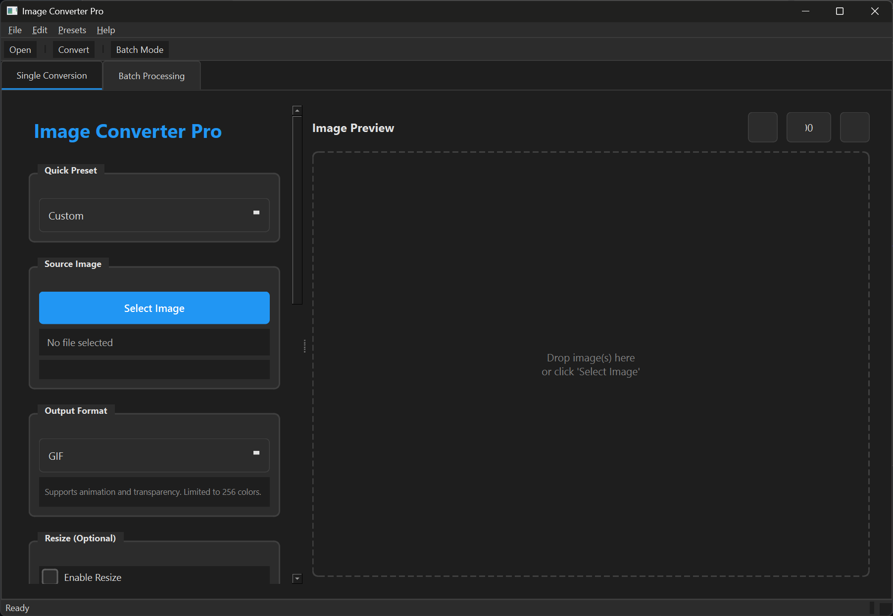

# Image Converter

A desktop image converter for Windows, macOS and Linux, built with PySide6.

Batch conversion, the adjustments that are usually buried three menus deep, and a preview before anything is written to disk. No account, no upload, no queue on somebody else's server.



## What it does

**Formats**
- Reads and writes JPEG, PNG, WebP, AVIF and HEIC/HEIF.
- AVIF and HEIC need an optional plugin (see Requirements). The format list only offers what your install can actually decode.
- Quality is adjustable per format; defaults are 85 for JPEG and WebP.

**Batch queue**
- Add one image, or open several at once, then convert the queue.
- Per-file progress, with pause, resume and stop for the whole run.
- Threaded processing, four workers by default, configurable.
- Output names follow your pattern, and a clash becomes `name (1).ext` rather than an overwrite.

**Adjustments**
- Brightness, contrast, saturation and sharpness.
- Resize by width, height, or both.
- Rotate and flip horizontally or vertically.
- Before-and-after preview with zoom, so you can see what the settings actually did.

**Metadata**
- Reads EXIF from the source.
- Can strip metadata entirely, including GPS location, while keeping orientation upright.

**Interface**
- Dark and light themes; it follows your choice, not the system's mood.
- The last ten files you opened, for when you are converting the same thing again.
- Settings persist between sessions: quality, threads, format and theme.
- Keyboard shortcuts for the common path, and `F1` lists them in the app.

## Requirements

- Python 3.8 or newer.
- PySide6 and Pillow:

```bash
pip install PySide6 Pillow
```

Optional, for the formats Pillow does not handle on its own:

```bash
pip install pillow-avif-plugin   # AVIF
pip install pillow-heif          # HEIC / HEIF, mostly iPhone photos
```

## Run it

```bash
python main.py
```

There is no build step and nothing to install globally.

## Keyboard shortcuts

| Shortcut | Action |
|---|---|
| `Ctrl+O` | Open image |
| `Ctrl+Shift+O` | Open several images (batch) |
| `Ctrl+S` | Save / convert |
| `F5` | Convert image |
| `Ctrl+B` | Add to batch queue |
| `Ctrl+Shift+C` | Clear batch queue |
| `Ctrl+Q` | Quit |
| `F1` | Show shortcuts |
| `+` / `-` | Zoom preview |

## Choosing a format

| If you want | Use | Because |
|---|---|---|
| A photograph that opens anywhere | JPEG, quality 85-92 | Universal, small, and losses stay invisible above 85. |
| Transparency only | PNG | Lossless, but files get large quickly. |
| Small files and transparency | WebP | Usually 25-35% smaller than JPEG at the same look. |
| The smallest file and you control the viewer | AVIF | Excellent compression, slower to encode, needs the plugin. |
| To keep an iPhone original | HEIC | Fine as an archive format; check that your destination accepts it. |

For screenshots and flat graphics, PNG or WebP beat JPEG at any quality setting. For photographs you will re-edit, keep the original and convert a copy.

## Project layout

```
main.py                window, controls, shortcuts, preview
config.py              settings, defaults and persistence
formats.py             format table, capability checks, save options
processor.py           decode, adjust, resize, EXIF handling, encode
batch_processor.py     queue, worker threads, pause/resume/stop, output naming
```

## Limits

- **Single-user desktop tool.** No tests, no installer, no plugins, no preset library beyond the built-in ones. It is a utility that does one job.
- **Colour management is basic.** It does not carry ICC profiles through every conversion; for print work, use something that does.
- **Metadata stripping is deliberate and permanent.** Once a file is written without EXIF, the camera data is gone. Keep the originals.

## Licence

GPL-3.0. See [LICENSE](LICENSE).

---

Built by [Martin Greer](https://github.com/esprit112).
